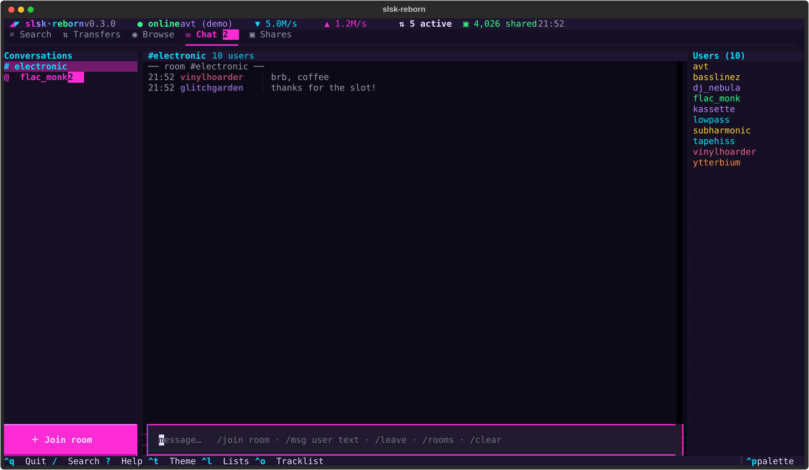

# slsk-reborn

A Soulseek client for the terminal, built on [Textual](https://textual.textualize.io/) and [aioslsk](https://github.com/JurgenR/aioslsk). You can search, download, share, browse users and chat without leaving the terminal.


## Features

- **Search**: each search gets its own tab and results stream in live. Results show a quality badge (green FLAC, bitrate for lossy files), the peer's speed and whether they have a free slot. You can filter as you type (`flac`, `>256`, `-live`) and sort by quality, speed, size or user. One key downloads a file, another downloads the whole album folder.
- **Transfers**: downloads and uploads update live with progress bars, speed, ETA and queue place. Keys pause, resume or retry, abort, remove, clear finished transfers and open the folder. Downloads keep the album folder structure.
- **Browse**: opens another user's shares as a folder tree with a file list. Press `d` on a folder to download it and everything below it.
- **Chat**: rooms with a user list, private messages, unread badges, highlights when someone mentions your name, and `/join` `/leave` `/msg` `/rooms` `/clear`.
- **Sharing**: add or remove shared folders and rescan them. You can also share your download folder, and set upload slots and upload/download speed limits, which apply live. UPnP port mapping is optional.
- **Looks**: three themes (`slsk-neon`, `slsk-amber`, `slsk-matrix`; cycle with `ctrl+t`), a top bar with live speeds, and a command palette (`ctrl+p`).
- **Demo mode**: `--demo` runs the whole UI against a simulated network, which is handy for trying it out without an account.

| Transfers | Browse |
|---|---|
|  |  |
| **Chat** | **Shares & settings** |
|  |  |

## Install

Requires Python 3.11 or newer.

```sh
pip install git+https://github.com/avtii/slsk-reborn
```

or, from a clone:

```sh
git clone https://github.com/avtii/slsk-reborn
cd slsk-reborn
pip install -e ".[dev]"
```

## Run

```sh
slsk-reborn            # connect (asks for login on first start)
slsk-reborn --demo     # offline demo with fake peers
slsk-reborn --theme slsk-matrix
python -m slsk_reborn  # same thing
```

On the first start a login box opens. A Soulseek account is created automatically the first time you log in with a new name. **Use a different account from any other Soulseek client you run.** The server allows only one session per name, so two clients on the same account keep kicking each other off.


## Keys

| Where | Key | Action |
|---|---|---|
| everywhere | `1`–`5` / `F2`–`F6` | switch tab |
| | `/` or `ctrl+f` | new search |
| | `esc` | leave a text box (so single-key shortcuts work) |
| | `?` / `F1` | help |
| | `ctrl+t` | cycle theme |
| | `ctrl+q` | quit (saves transfers) |
| search results | `enter` / `d` | download file |
| | `f` | download whole folder |
| | `b` / `i` / `m` | browse user / user info / message |
| | `s` | cycle sort |
| | `ctrl+w` | close search tab |
| transfers | `p` `r` `x` `del` | pause, resume/retry, abort, remove |
| | `c` / `o` | clear finished / open folder |
| browse | `d` on a folder | download it and its subfolders |

The filter box above the results takes words to include, `-word` to exclude, `flac`/`mp3`/`lossless` for format, and `>256` for a minimum bitrate.

## Files

Everything lives in `~/.slsk-reborn/` (set `SLSK_REBORN_HOME` to move it):

- `config.toml`: account, folders, limits, theme, rooms. It is written with `chmod 600` because it holds your password.
- `shares/` and `transfers/`: caches, so the shares index and the transfer queue survive restarts.
- `slsk-reborn.log`: run with `--debug` for full protocol logging.

Downloads go to `~/Music/slsk-reborn` by default. You can change this in the Shares tab.

**Port:** the default listening port is `61000`. Forward it on your router, or enable UPnP, so that other peers can connect to you. If they can't, some uploads and downloads will fail to start.

## Development

```sh
pytest                       # UI tests run against the demo engine
python docs/make_screenshots.py
```

The UI talks only to an `Engine` interface (`slsk_reborn/engine.py`) through plain dataclasses and a small event bus. `SlskEngine` wraps aioslsk, and `DemoEngine` (`slsk_reborn/demo.py`) simulates the network for tests and screenshots.

## License

MIT
