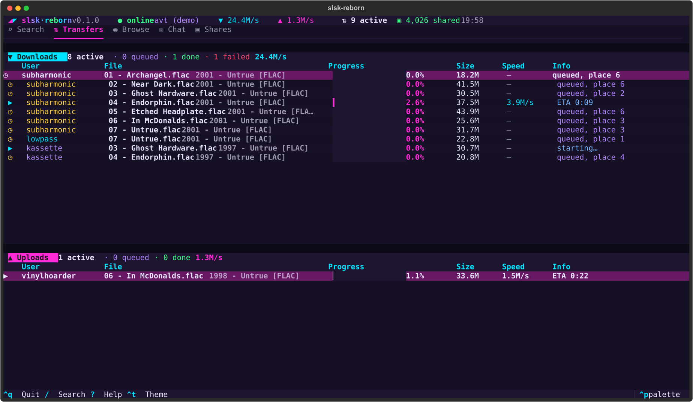
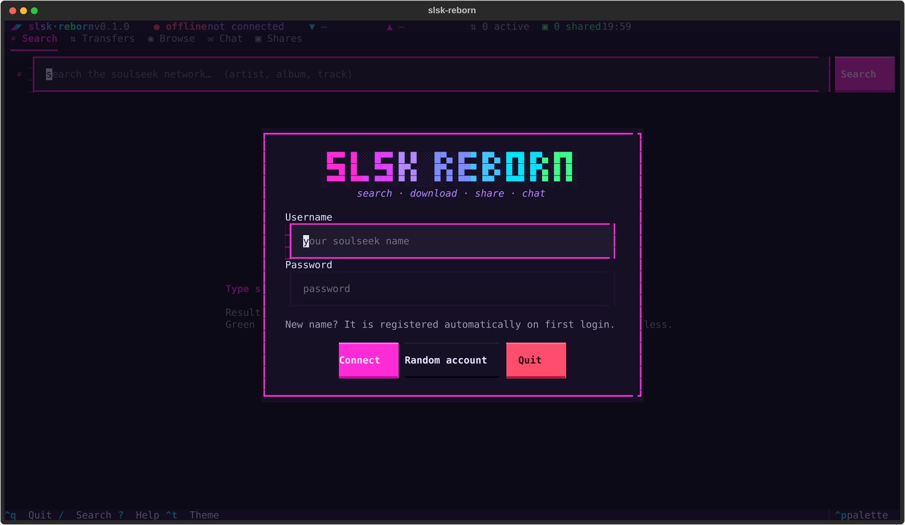

# slsk-reborn

A Soulseek client for the terminal, built on [Textual](https://textual.textualize.io/) and [aioslsk](https://github.com/JurgenR/aioslsk). You can search, download, share, browse users and chat without leaving the terminal.


## Features

- **Search**: each search gets its own tab and results stream in live. Results show a quality badge (green FLAC, bitrate for lossy files), the peer's speed and whether they have a free slot. You can filter as you type (`flac`, `>256`, `-live`) and sort by quality, speed, size or user. One key downloads a file, another downloads the whole album folder. Stop a search with `x` or the Stop button; each search also stops itself at 10,000 files.
- **Transfers**: downloads and uploads update live with progress bars, speed, ETA and queue place. Keys pause, resume or retry, abort, remove, clear finished transfers and open the folder. Downloads keep the album folder structure.
- **Browse**: opens another user's shares as a folder tree with a file list. Press `d` on a folder to download it and everything below it.
- **Chat**: rooms with a user list, private messages, unread badges, highlights when someone mentions your name, and `/join` `/leave` `/msg` `/rooms` `/clear`.
- **Sharing**: pick folders to share with a built-in folder browser (drives, home, Music), or type a path. Remove or rescan them. You can also share your download folder, and set upload slots and upload/download speed limits, which apply live. UPnP port mapping is optional.
- **Looks**: three themes (`slsk-neon`, `slsk-amber`, `slsk-matrix`; cycle with `ctrl+t`), a top bar with live speeds, and a command palette (`ctrl+p`).
- **Demo mode**: `--demo` runs the whole UI against a simulated network, which is handy for trying it out without an account.

| Transfers | Browse |
|---|---|
|  |  |
| **Chat** | **Shares & settings** |
|  |  |

## Download

Ready-to-run executables (no Python needed) are on the [Releases page](https://github.com/avtii/slsk-reborn/releases/latest):

| System | File |
|---|---|
| Windows 10/11 (64-bit) | `slsk-reborn-windows-x64.exe` |
| macOS, Apple Silicon (M1 and later) | `slsk-reborn-macos-arm64` |
| macOS, Intel | `slsk-reborn-macos-x64` |
| Linux x86-64 (glibc 2.35+) | `slsk-reborn-linux-x64` |
| Linux ARM64 (glibc 2.35+, e.g. Raspberry Pi 4/5 with a 64-bit OS) | `slsk-reborn-linux-arm64` |

Run them from a terminal: Windows Terminal on Windows, Terminal or iTerm2 on macOS.

- **Windows:** SmartScreen may warn about an unknown publisher because the exe is not signed. Click *More info* → *Run anyway*.
- **macOS:** the binary is not notarized. Make it executable and clear the quarantine flag once:
  ```sh
  chmod +x slsk-reborn-macos-arm64
  xattr -d com.apple.quarantine slsk-reborn-macos-arm64
  ./slsk-reborn-macos-arm64
  ```

## Linux

### Ready-made binary

Works on any glibc distro from 2022 on: Ubuntu 22.04+, Debian 12+, Fedora 36+, Linux Mint 21+,
Pop!_OS 22.04+, Arch, Manjaro, openSUSE Leap 15.5+/Tumbleweed, and others.

```sh
curl -LO https://github.com/avtii/slsk-reborn/releases/latest/download/slsk-reborn-linux-x64
chmod +x slsk-reborn-linux-x64
sudo install -m 755 slsk-reborn-linux-x64 /usr/local/bin/slsk-reborn
slsk-reborn
```

On ARM64 use `slsk-reborn-linux-arm64`. Alpine and other musl distros can't run the binary; use one of
the Python installs below.

### Install with Python (any distro)

Distros mark the system Python as externally managed, so install into an isolated tool environment
with **pipx** or **uv**. You get a `slsk-reborn` command on your PATH, and updating is one command.

| Distro | Setup | Install |
|---|---|---|
| Ubuntu 24.04+, Debian 12+, Mint 22+ | `sudo apt install pipx git && pipx ensurepath` | `pipx install git+https://github.com/avtii/slsk-reborn` |
| Fedora | `sudo dnf install pipx git && pipx ensurepath` | same |
| Arch, Manjaro, EndeavourOS | `sudo pacman -S python-pipx git && pipx ensurepath` | same |
| Ubuntu 22.04, Mint 21, openSUSE, others | `curl -LsSf https://astral.sh/uv/install.sh \| sh` | `uv tool install git+https://github.com/avtii/slsk-reborn` |

Open a new terminal after `ensurepath` or the uv installer so the PATH change applies. Update with
`pipx upgrade slsk-reborn` or `uv tool upgrade slsk-reborn`. Python 3.11+ is needed. On Ubuntu 22.04
(Python 3.10) use the uv line, which downloads a current Python on its own.

### Build the executable yourself

```sh
# Debian/Ubuntu: sudo apt install git python3-venv binutils
# Fedora:        sudo dnf install git python3 binutils
# Arch:          sudo pacman -S git python binutils
git clone https://github.com/avtii/slsk-reborn
cd slsk-reborn
python3 -m venv .venv && . .venv/bin/activate
pip install . pyinstaller
python packaging/build.py          # -> dist/slsk-reborn-linux-<arch>
./dist/slsk-reborn-linux-* --self-test
```

PyInstaller uses `objdump` from binutils. The binary only runs on systems with the same or a newer glibc
than the one it was built on.

## Install from source

Requires Python 3.11 or newer.

```sh
pip install git+https://github.com/avtii/slsk-reborn
```

or, from a clone:

```sh
git clone https://github.com/avtii/slsk-reborn
cd slsk-reborn
pip install -e ".[dev]"
```

## Run

```sh
slsk-reborn            # connect (asks for login on first start)
slsk-reborn --demo     # offline demo with fake peers
slsk-reborn --theme slsk-matrix
slsk-reborn --port 2234  # listening port for this run (also uses 2235)
python -m slsk_reborn  # same thing
```

On the first start a login box opens. A Soulseek account is created automatically the first time you log in with a new name. **Use a different account from any other Soulseek client you run.** The server allows only one session per name, so two clients on the same account keep kicking each other off.



## Keys

| Where | Key | Action |
|---|---|---|
| everywhere | `1`–`5` / `F2`–`F6` | switch tab |
| | `/` or `ctrl+f` | new search |
| | `esc` | leave a text box (so single-key shortcuts work) |
| | `?` / `F1` | help |
| | `ctrl+t` | cycle theme |
| | `ctrl+q` | quit (saves transfers) |
| search results | `enter` / `d` | download file |
| | `f` | download whole folder |
| | `b` / `i` / `m` | browse user / user info / message |
| | `s` | cycle sort |
| | `x` | stop search (keeps the results) |
| | `ctrl+w` | close search tab |
| transfers | `p` `r` `x` `del` | pause, resume/retry, abort, remove |
| | `c` / `o` | clear finished / open folder |
| browse | `d` on a folder | download it and its subfolders |

The filter box above the results takes words to include, `-word` to exclude, `flac`/`mp3`/`lossless` for format, and `>256` for a minimum bitrate.

## Files

Everything lives in `~/.slsk-reborn/` (set `SLSK_REBORN_HOME` to move it):

- `config.toml`: account, folders, limits, theme, rooms. It is written with `chmod 600` because it holds your password.
- `shares/` and `transfers/`: caches, so the shares index and the transfer queue survive restarts.
- `slsk-reborn.log`: run with `--debug` for full protocol logging.

Downloads go to `~/Music/slsk-reborn` by default. You can change this in the Shares tab.

**Port:** the default listening port is `61000` (plus `61001` for obfuscated connections). Change it in the Shares tab or for a single run with `--port N` / `-p N`. Forward it on your router, or enable UPnP, so that other peers can connect to you. If they can't, some uploads and downloads will fail to start.

## Development

```sh
pytest                       # UI tests run against the demo engine
python docs/make_screenshots.py
pip install pyinstaller && python packaging/build.py   # executable for this OS in dist/
```

Pushing a `v*` tag runs `.github/workflows/release.yml`. It builds the Windows and macOS executables, runs `--self-test` on each, and publishes them as a GitHub release.

The UI talks only to an `Engine` interface (`slsk_reborn/engine.py`) through plain dataclasses and a small event bus. `SlskEngine` wraps aioslsk, and `DemoEngine` (`slsk_reborn/demo.py`) simulates the network for tests and screenshots.

## License

MIT
